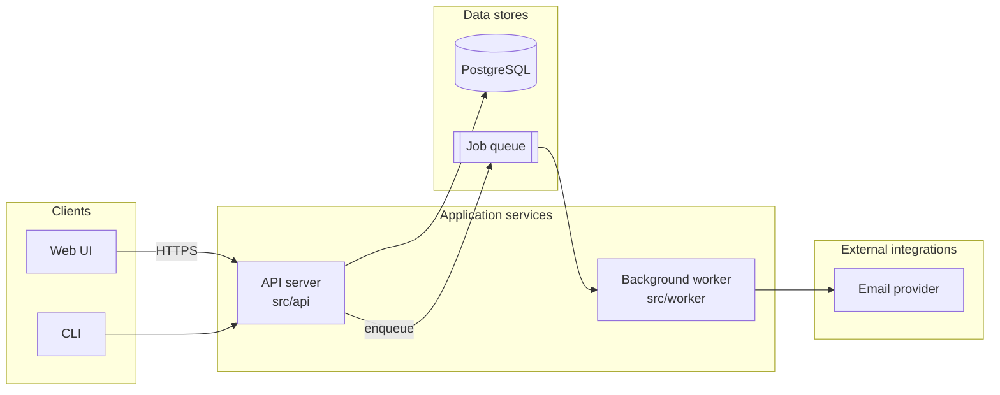
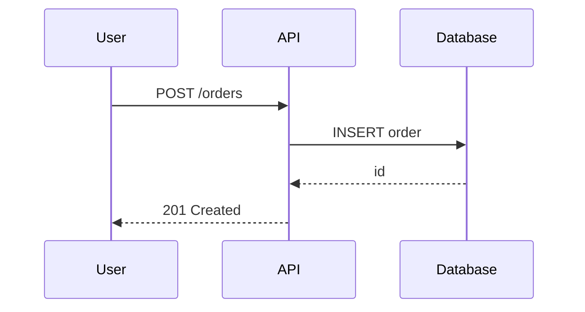

# GitHub-compatible Mermaid

GitHub renders fenced blocks tagged `mermaid`. Broken syntax shows a red error box, so follow these rules.

## Flowchart (architecture)

Rules:
- Start with `flowchart TB` or `flowchart LR`.
- Give every node a short unique ASCII id (`API`, `DB`) and quote the label: `API["API server"]`. Quote any label containing `()`, `/`, `:`, `;`, `,`, `&`, `#`, `<`, `>`.
- Use ` ` for line breaks inside quoted labels.
- Never use `end` as a node id or bare label word (use `End` or quote it).
- Close every `subgraph` with `end`. Subgraph ids with spaces need `id["Title"]`.
- Edge labels: `A -->|label| B`. Avoid special characters in them.
- Shapes: `[...]` box, `([...])` stadium, `[(...)]` database, `[[...]]` subroutine, `{...}` decision.
- Keep to about 25 nodes. Split into a second diagram (for example per subsystem) instead of one unreadable one.

## Coverage rule
Every major component in the Component Inventory table appears in the diagram, and every edge corresponds to an import, call, or connection you verified. Planned components may appear with a dashed style and a `Planned` label:
`NEW["Search service (Planned)"]:::planned` with `classDef planned stroke-dasharray: 5 5;`

## Sequence diagram (execution flow)

- Declare participants first with aliases. Use `->>` for calls and `-->>` for replies.
- `alt`/`opt`/`loop`/`par` blocks each need an `end`.
- Avoid `;` and unescaped `#` in message text.

## Deployment diagram
Use `flowchart` with subgraphs for environments (Dev, Staging, Prod) or network zones; nodes are containers, services, or cloud resources found in infra code.

## Checking
`scripts/validate_readme.py` does static checks (type line, balanced brackets, subgraph/`end` pairing, unquoted special characters). It does not render. If `npx` and network are available and the user approves, `npx -y @mermaid-js/mermaid-cli -i README.md -o /tmp/out.md` renders every block and fails on syntax errors. Otherwise say rendering was not verified.
