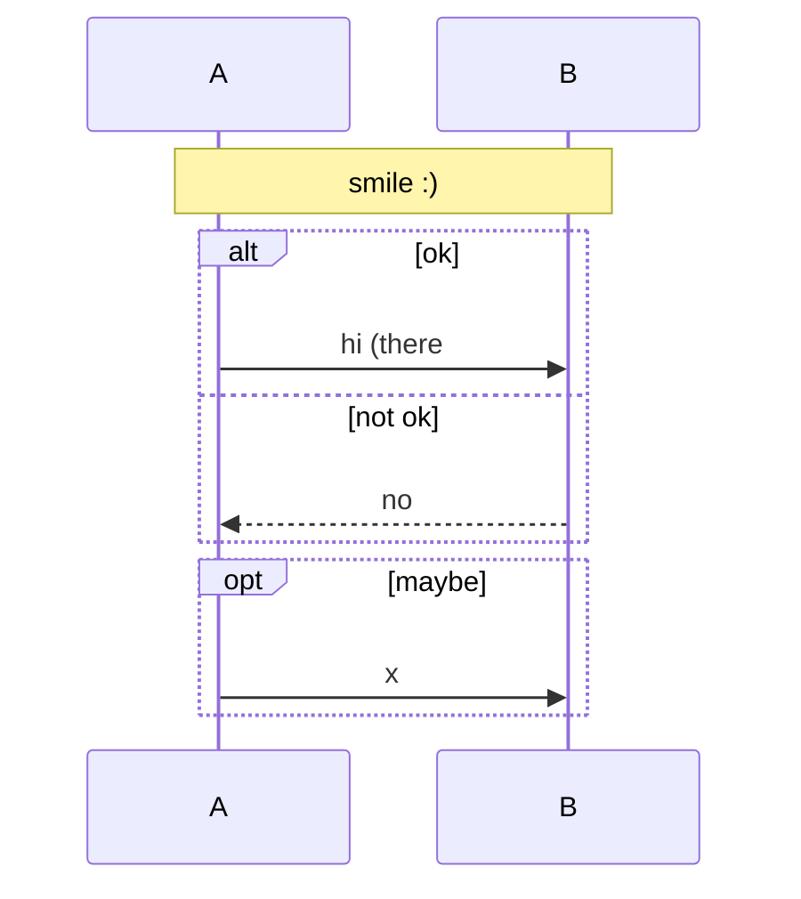
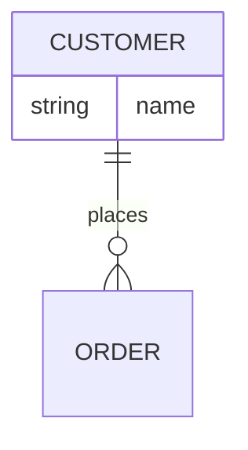
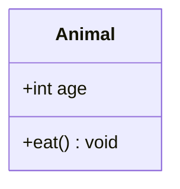
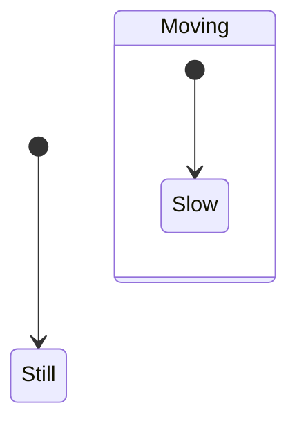

Setext Title
============

Intro text with a [spaced file](docs/my%20file.md) and [HTML anchor](#custom-anchor) and [ref link][r1] and [broken ref][r2].

<a id="custom-anchor"></a>

Second Section
--------------

[r1]: docs/real.md
[r2]: docs/missing.md

```mermaid
flowchart LR
    DB[(PostgreSQL)]
    S([Start]) --> X[[Sub routine]]
    H{{Hex}} --> opt
    opt --> DB
    A -->|call (x)| B
    classDef planned stroke-dasharray: 5 5;
    class A,B planned
    subgraph one["One (1)"]
        N1
    end
```








