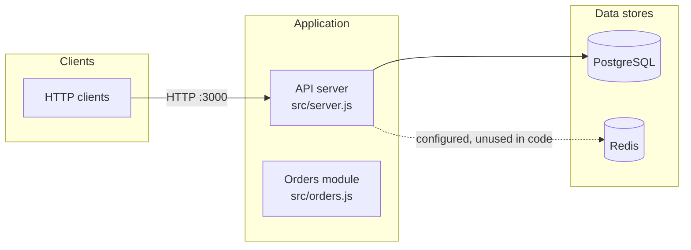

# orders-api

> REST API for managing customer orders.

## Table of Contents

- [Project Overview](#project-overview)
- [Documentation](#documentation)
- [Technology Stack](#technology-stack)
- [High-Level Logical Architecture](#high-level-logical-architecture)
- [Component Inventory](#component-inventory)
- [Repository Structure](#repository-structure)
- [Application Execution Flow](#application-execution-flow)
- [Development Prerequisites](#development-prerequisites)
- [Local Development Setup](#local-development-setup)
- [Build Instructions](#build-instructions)
- [Running the Application](#running-the-application)
- [Testing](#testing)
- [Configuration](#configuration)
- [APIs and Interfaces](#apis-and-interfaces)
- [Deployment Architecture](#deployment-architecture)
- [Troubleshooting](#troubleshooting)
- [Development Guidelines](#development-guidelines)
- [Known Limitations and Future Work](#known-limitations-and-future-work)

## Project Overview

`orders-api` is an Express service that exposes order endpoints backed by PostgreSQL ([`src/server.js`](src/server.js)). Users: TBD (not documented in the repository).

## Documentation

| Document | Contents |
|---|---|
| [AGENTS.md](AGENTS.md) | Instructions for coding agents: commands, conventions, boundaries |
| [docs/codebase-map.md](docs/codebase-map.md) | Where code lives and where to change what |
| [docs/architecture.md](docs/architecture.md) | Components, flows and diagrams |
| [docs/configuration.md](docs/configuration.md) | Environment variables and config files |
| [docs/development-guide.md](docs/development-guide.md) | Setup, build, run, test, CI |

Not applicable: data model (no schema or migrations in the repository), security and deployment documents (see README sections).

## Technology Stack

| Layer | Technology | Purpose | Source |
|---|---|---|---|
| Runtime | Node.js >= 20 | Application runtime | [`package.json`](package.json) |
| Web framework | Express 4 | HTTP routing | [`package.json`](package.json) |
| Database | PostgreSQL 16 (`pg` driver) | Order storage | [`docker-compose.yml`](docker-compose.yml) |
| Cache | Redis 7 | Declared in compose and `REDIS_URL`; no client calls found in `src/` | [`docker-compose.yml`](docker-compose.yml) |
| Tests | Jest | Unit tests | [`package.json`](package.json) |

## High-Level Logical Architecture



The API server registers `/health` and `/orders` routes and queries PostgreSQL through a `pg` pool. `src/orders.js` exports a `list` stub and is not yet imported by the server. Redis is provisioned but no code uses it (`REDIS_URL` is read into a variable only).

## Component Inventory

| Component | Responsibility | Source location | Depends on |
|---|---|---|---|
| API server | Express app, routes, DB pool | [`src/server.js`](src/server.js) | `express`, `pg`, PostgreSQL |
| Orders module | Order listing stub | [`src/orders.js`](src/orders.js) | none |
| PostgreSQL | Order storage | `db` service in [`docker-compose.yml`](docker-compose.yml) | none |
| Redis | Provisioned cache | `cache` service in [`docker-compose.yml`](docker-compose.yml) | none |

## Repository Structure

```text
.
├── .github/workflows/ci.yml   # CI: npm ci, npm test
├── src/
│   ├── server.js              # Express entry point
│   └── orders.js              # orders module (stub)
├── tests/orders.test.js       # Jest test
├── docker-compose.yml         # api, db, cache services
├── Dockerfile                 # node:20-alpine image
├── .env.example               # configuration template
└── package.json
```

## Application Execution Flow

1. `src/server.js` creates the Express app and a `pg` pool from `DATABASE_URL`.
2. Routes `/health`, `GET /orders`, `POST /orders` are registered.
3. The app listens on `PORT` (default 3000).
4. `GET /orders` runs `select * from orders`. `POST /orders` returns 201 with an empty body; persistence is not implemented. Graceful shutdown: TBD (no handler found).

## Development Prerequisites

- Node.js 20 or newer (`engines` in [`package.json`](package.json)).
- Docker and Docker Compose for PostgreSQL and Redis.
- Database schema/migrations: TBD (none found in the repository).

## Local Development Setup

```bash
npm ci
cp .env.example .env
docker compose up -d db cache
npm run dev
```

Not executed while writing this README; commands are taken from `package.json` and `docker-compose.yml`.

## Build Instructions

No build step: the service runs directly with `node src/server.js`. Container image: `docker compose build api`.

## Running the Application

```bash
npm start
```

Listens on port 3000 by default; health check at `GET /health`. Logging and debugging: TBD.

## Testing

```bash
npm test
```

Jest, one test file: [`tests/orders.test.js`](tests/orders.test.js). Lint: `npm run lint`.

## Configuration

| Variable | Description | Required | Default | Used in |
|---|---|---|---|---|
| `DATABASE_URL` | PostgreSQL connection string | Yes | none | [`src/server.js`](src/server.js) |
| `REDIS_URL` | Redis connection URL | No | none | [`src/server.js`](src/server.js) |
| `PORT` | HTTP listen port | No | `3000` | [`src/server.js`](src/server.js) |

Copy [`.env.example`](.env.example) to `.env`; never commit real credentials.

## APIs and Interfaces

| Method | Path | Purpose | Auth |
|---|---|---|---|
| GET | `/health` | Liveness check | none found |
| GET | `/orders` | List orders | none found |
| POST | `/orders` | Create order (stub) | none found |

No OpenAPI specification in the repository.

## Deployment Architecture

[`Dockerfile`](Dockerfile) builds the API image and [`docker-compose.yml`](docker-compose.yml) runs `api`, `db` and `cache`. CI: [`.github/workflows/ci.yml`](.github/workflows/ci.yml) runs `npm ci` and `npm test`. No other environments are defined.

## Troubleshooting

| Symptom | Likely cause | Fix |
|---|---|---|
| Server fails querying orders | `DATABASE_URL` unset or database not running | Set it in `.env` and start `db` |

## Development Guidelines

ESLint is configured via the `lint` script. Other conventions: TBD.

## Known Limitations and Future Work

- `POST /orders` does not persist data. Redis is provisioned but unused. No migrations or auth found.

<!-- repo-readme-generator: commit=0000000 date=2026-11-02 -->
