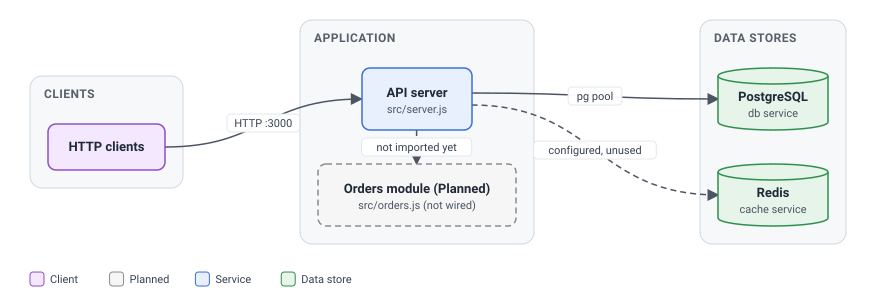
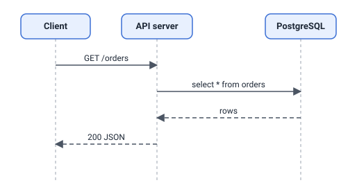

# Architecture

> Components, interactions and flows of orders-api, for engineers and agents changing the system.

- **Status:** Verified against commit `0000000` on 2026-11-03
- **Legend:** Implemented = found in code · Planned = documented intent · TBD = unknown, needs an owner
- **Related:** [Codebase map](codebase-map.md) · [Configuration](configuration.md)

## Logical architecture

The API server is the only running application component. It registers `/health`, `GET /orders` and `POST /orders` and queries PostgreSQL directly ([`src/server.js`](../src/server.js)). Redis is provisioned in compose and `REDIS_URL` is read, but no client calls exist. `src/orders.js` is a stub that the server does not import. Dashed lines and the dashed box mark these not-yet-real parts.

## Components

| Component | Responsibility | Interfaces | Depends on | Status |
|---|---|---|---|---|
| API server | HTTP routing, DB access | `GET /health`, `GET /orders`, `POST /orders` | `express`, `pg`, PostgreSQL | Implemented |
| Orders module | List orders (stub) | `list()` | none | Implemented, unused |
| PostgreSQL | Order storage | SQL via `DATABASE_URL` | none | Provisioned; schema TBD |
| Redis | Cache | none used | none | Provisioned only |

## Key flows

`POST /orders` currently returns 201 with an empty body and does not persist anything.

## Cross-cutting concerns

- **Configuration:** environment variables, see [Configuration](configuration.md).
- **Error handling, logging, authentication:** none implemented in `src/server.js` (TBD).
- **Shutdown:** no graceful shutdown handler found.

## Open questions (TBD)

- Database schema and migrations; intended use of Redis; authentication.
